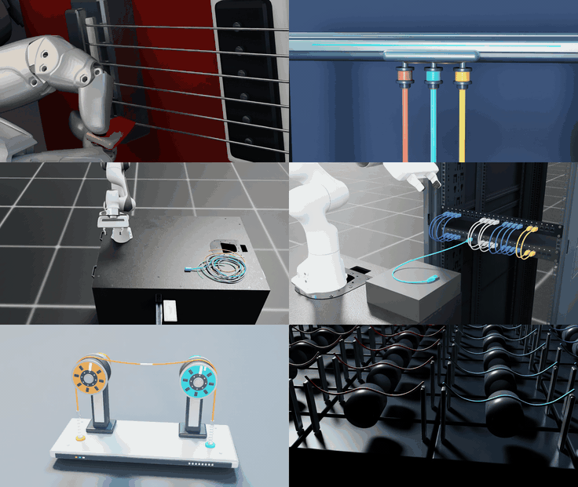

# DeformX video showcase

The top GIF/video is one two-column, three-row composition. Use the scene links below for full MP4s. Videos replay saved simulation states. Playback rate and computation speed are different quantities.

| Scene | Full clip | Run / availability |
|---|---|---|
| [Humanoid guitar](humanoid_guitar/README.md) | [15.93 s, 4× slow → 1×](humanoid_guitar/media/humanoid-guitar-fullbody-long.mp4) | `python -m demo.examples guitar --assets runs/guitar-assets --out runs/guitar` · prepare assets first |
| [Three-strand braider](braiding_machine/README.md) | [21 s, 1×](braiding_machine/media/braiding-process-hold-854cb279.mp4) | `python -m demo.examples braid --preset process --out runs/braid` |
| [Robot cable extraction](cable_extraction/README.md) | [18.7 s, 2×](cable_extraction/media/cable-extraction.mp4) · [37.4 s, 1×](cable_extraction/media/cable-extraction-1x.mp4) | [Setup and launch commands](cable_extraction/README.md#reproduce-on-an-isaacdeformx-workstation); requires Isaac Lab and Panda/table assets |
| [Robot rack insertion](rack_insertion/README.md) | [patching, 19.9 s, 1×](rack_insertion/media/rack-patching.mp4) · [earlier single cable, 14.8 s](rack_insertion/media/rack-insertion.mp4) | `python -m demo.examples rack-insertion --profile runs/rack-assets/profile.json --out runs/rack-trial` · Isaac Lab |
| [Traction reels](winch_tension/README.md) | [eight cycles, 1×](winch_tension/media/winch-tension-long.mp4) | `python -m demo.examples winch --cycles 8 --out runs/reels` |
| [Moving-guide arena](contact_arena/README.md) | [24 s, 1×](contact_arena/media/contact-arena-pullback-5660e2a3.mp4) | `python -m demo.examples contact-arena --worlds 64 --seconds 2 --out runs/arena` |
| [Dense cable cascade](cable_cascade/README.md) | [6 s, 1×](cable_cascade/media/cable-cascade.mp4) | `python -m demo.examples cascade --out runs/cascade` |
| [Six basic examples](basics/README.md) | [video index](basics/README.md) | [Commands for all six](EXAMPLES.md#choose-a-scene) |

Use the [CUDA setup](EXAMPLES.md#installation), then run the standalone commands from the repository root with a fresh output directory. They save simulation data; each example README documents the separate rendering steps. The arena command is a quick check; its reference video used `--worlds 1024 --seconds 24` and displays 64 worlds.

## Reproduction and interpretation

Start with the [installation and catalog](EXAMPLES.md). Each runnable case documents settings, controls, saved data and optional rendering. Solver completion is distinct from task success. The braider's refined reference comparison does not pass every geometric convergence gate; its README describes this limitation.

The original basic, braider, reel, arena and guitar trajectories came from experiment revision `5de1d32` using CUDA backend `708e0a9`. Their text-free videos replay those same saved states. The cascade and rack insertion have separate trajectory hashes and recording evidence in their folders. The cable extraction is a new physical run using the pinned release backend, with its own task audit and open-gripper control. Fresh guitar, rack and cascade runs are documented separately in their READMEs. Archived gallery recordings are distinct from these new task results and the original nine-case release checks. Timing, controls and model limits appear in each example’s documentation.

The 21-second combined preview includes the complete braiding recording at 1×. Extraction plays its full 18.7-second accelerated recording from the beginning, then holds its final frame for 2.3 seconds. Rack insertion plays its full 19.9-second patching recording at 2×, holds its final frame for half a second, and is shown twice. The other three panels repeat their eight-second excerpts: guitar begins with a 0.5× pick close-up and pullback, followed by a 1× full-body view; traction reels and the arena play at 1×. The cascade remains available in the full-video list. [Composition trims and hashes](media/gpu-showcase-provenance.json) record the source ranges, repeats and frame checks of the braider, extraction and rack insertion panels. The standalone [braider animation](braiding_machine/media/braiding-process-hold-b9c1a215.gif) also covers the full 21 seconds. Individual [preview exports](media/gallery-preview-provenance.json) remain available as additional media.

The braider descends from the carriers to where the strands converge, holds on the forming braid for five seconds, then pulls back to the complete machine ([camera record](braiding_machine/presentation.json)). The arena opens on cable–guide contact, then pulls back to the full 8×8 display by 5.5 s. Its [camera and capture record](contact_arena/presentation.json) binds the revised 24-second replay to the original 720 saved states; the standalone arena animation covers that full replay.

The six-panel edit preserves the playback timeline of its inputs. [Clean replay provenance](media/clean-replay-provenance.json) records the earlier trajectory and output hashes, including the braider's wider Blender frame, downward traverse to the crossings and subsequent pullback to the complete machine. Its [composition script](media/render_gpu_showcase.py) combines the six packaged MP4s without text overlays. The edit adds no new simulation; repeated excerpts, the 2× rack insertion playback and the end holds are presentation edits, not additional simulated time.

[Rendering stability review](media/render-stability-review.json) covers all six panels: native/encoded measurements, retained recordings and corrected replays. Extraction's 2× presentation is separate from its original 1× capture and the solver timing.

## Credits

Basic, braider, reel and arena display props were built for these examples in Blender; simulation and rendering code are included. The guitar uses the assets listed in [its credits](humanoid_guitar/README.md#assets-and-provenance). The rack insertion reuses NVIDIA and Vertiv models, a Newton connector asset and a third-party patch panel; see [its credits](rack_insertion/README.md#assets-and-provenance). The extraction uses official NVIDIA Panda/table assets and an original Blender pull tab, as described in [its README](cable_extraction/README.md). All footage is from DeformX simulation and Isaac Sim rendering.

README organization was informed by [Newton](https://github.com/newton-physics/newton/blob/main/README.md) and [SolverFBA](https://github.com/PranaLabs/newton/blob/ziqiu/fba-solver/README.md). Their solver, benchmarks and media are separate projects.
