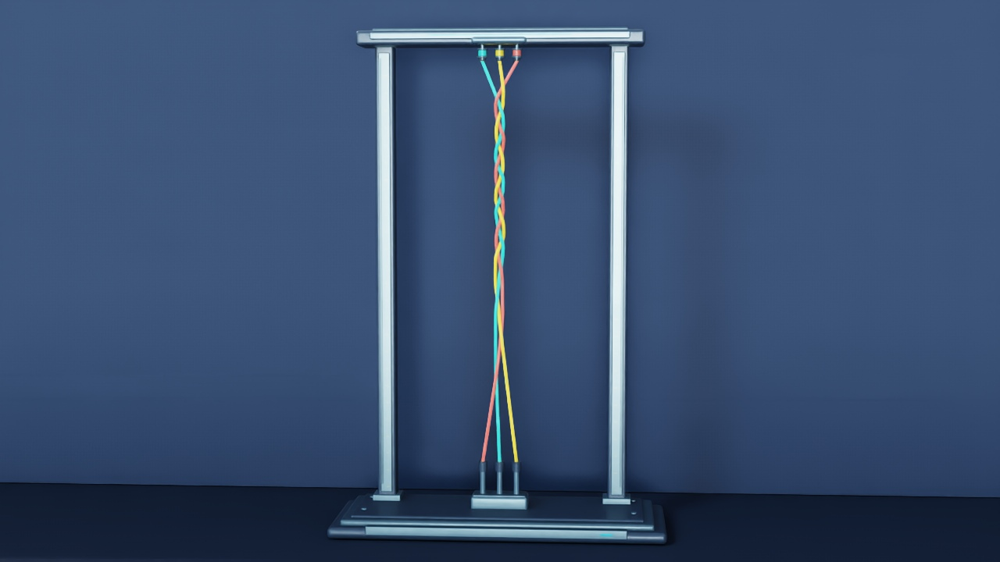

# Three-strand braider

Three rods start straight. Prescribed upper carriers exchange adjacent slots and the lower grips stay fixed. Native rod–rod contact acts on the dynamic strand interiors as the strands braid.

[Watch 20 carrier exchanges at 1×](media/braiding-process-hold-854cb279.mp4)

The [animated preview](media/braiding-process-hold-b9c1a215.gif) and the braider panel in the repository's combined preview both play this complete 21-second recording at 1×.



## Run

Use the [CUDA example setup](../EXAMPLES.md). Run from the repository root with NumPy, CUDA-enabled PyTorch and `ropesim`. Choose a fresh output directory for each run.

```bash
python -m demo.examples braid --out runs/braid-short
python -m demo.examples braid --preset process --out runs/braid-process
python -m demo.braiding_machine.analyze --data runs/braid-process
```

The default `short` preset uses three exchanges with 25 vertices per strand. The `process` preset uses 20 one-second exchanges, a 2.52 m free span, 97 vertices per strand, 60 saved states per second and 48 CUDA substeps per saved interval. The carrier moves for 0.85 s with a cosine speed ramp at each end, then pauses for 0.15 s. The final exchange is followed by a one-second hold. The reference replay spans 21 seconds, starting at source t = 0.30 s.

## Compare contact and resolution

```bash
python -m demo.examples braid --preset process --no-contact --out runs/braid-contact-off
python -m demo.examples braid --preset process --no-drive --out runs/braid-parked
python -m demo.examples braid --preset process-refined --out runs/braid-refined
python -m demo.braiding_machine.compare --preset process --nominal runs/braid-process \
  --no-contact runs/braid-contact-off --no-drive runs/braid-parked --refined runs/braid-refined
```

The analyzer checks signed crossing order at held checkpoints, crossing spacing and depth, segment strain, endpoint error and sampled clearance. See [criteria.json](criteria.json) for the thresholds. The reference nominal run formed all 20 signed crossings and had 22.55 mm minimum sampled inter-strand centerline clearance. Contact off lost the order and reduced that clearance to 0.042 mm. Parked carriers produced zero crossings.

The refined preset uses 129 vertices and 120 Hz saved states. In the reference comparison it retained the signed order but exceeded the preset crossing-height shift limit and missed the minimum spacing limit. The comparison exits with status 1 when any gate fails and prints the individual checks. Read numerical `complete` and behavioral `task_success` separately in each run report. The saved geometry and contact-off control support the contact comparison. The check measures discrete frames and uses illustrative material values.

`trajectory.npz` stores seconds in `t`, strand and carrier positions in metres, velocities, XYZW quaternions and rest lengths. `solver_timing_ms.npy` stores synchronized step times. The machine frame and spool bodies are Blender props. The simulation drives only carrier endpoints and keeps the lower grips fixed.

## Replay saved states

Use Blender with USD export, then Isaac Sim Python with Pillow and FFmpeg/libx264. The renderer reads exact 30 fps source samples and holds the physics clock fixed.

```bash
blender -b --factory-startup --python-exit-code 1 \
  --python demo/braiding_machine/blender_assets.py -- --preset process --out runs/braid-hardware
# Optional wider display frame used in the reference video.
blender -b --factory-startup --python-exit-code 1 \
  --python demo/braiding_machine/widen_frame.py -- \
  --assets runs/braid-hardware --out runs/braid-hardware-wide --width 2.1
# Run with the Isaac Sim Python interpreter.
python -m demo.braiding_machine.render --data runs/braid-process \
  --assets runs/braid-hardware-wide --out runs/braid-video
```

The optional Blender frame is 2.10 m wide and 3.16 m high. It changes only the display structure; the grips, carrier paths and simulated strands are unchanged ([asset manifest](media/wide-frame-assets.json)). Use `runs/braid-hardware` if you skip widening.

The 21-second reference video starts at the top carriers, descends during seconds 1–4, holds on the forming braid just below the carriers for seconds 4–9, then pulls back during seconds 9–13. The final 8 seconds show the complete machine, with all motion at 1×. See the [camera record](presentation.json) and [reference replay recipe](media/replay_reference_camera_hold.py). The recipe requires the archived recording and assets; use the command above for new runs.

Append `--preview` for five representative frames. Use the same preset and model source when generating hardware for the recording.
