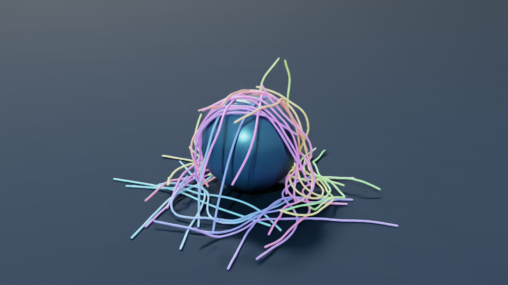

# Dense cable cascade

[](media/cable-cascade.mp4)

[Play the recorded showcase](media/cable-cascade.mp4)

Forty-eight free cables fall onto a spherical obstacle and the floor, folding and sliding against one another. All 48 belong to a single interacting contact group. Each cable has 33 vertices, with 120 Hz outer steps, 200 substeps and 24 solver iterations in the reference run.

## Run from source

Follow the [standalone CUDA installation](../EXAMPLES.md#installation) for the pinned DeformX backend. The solver uses NumPy, CUDA-enabled PyTorch and `ropesim`. The floor is an analytic plane and the sphere is a sampled analytic signed-distance field. The simulator generates both fixtures at startup.

Run these commands from the repository root in the CUDA environment.

```bash
python -m demo.examples cascade --out runs/cascade
python -m demo.cable_cascade.audit --data runs/cascade --reference
```

The solver writes `trajectory.npz`, `report.json`, `diagnostics.json` and `timings_ms.npy`. The reference audit checks the file hashes, seeded layout, finite states, frame cadence, strain limit, sampled contact proximity and solver contact barrier tolerance. The default run records both endpoints of the six-second interval for 181 states. Its duration, cable count (1–48), initial yaw and tilt seed, substeps and iterations can be set from the command line. Use a fresh output directory each time. The duration must be a multiple of 1/30 second.

```bash
python -m demo.examples cascade --help
python -m demo.examples cascade --count 4 --seconds 0.2 --out runs/cascade-smoke
python -m demo.cable_cascade.audit --data runs/cascade-smoke
```

The report checks position, velocity, quaternion, strain and solver flags each outer step. Clearance is measured at roughly 10 Hz. Cross-rod gaps subtract the cable diameter from segment distance. Sphere and floor gaps subtract one cable radius from the distance to the fixture surface. Negative surface gaps indicate overlap. The solver uses a 5.715 mm effective rod contact radius and a 6.35 mm visual radius. Analytic sphere distances can differ from the 4 mm interpolated solver grid. These measurements describe sampled states. Penetration and crossing behavior between samples is unmeasured.

## Render the generated trajectory

Use the [Isaac Sim environment](../../README.md#environment-setup) with Pillow, FFmpeg with libx264, and FFprobe on PATH. Tested with Isaac Sim 5.1.0, Pillow 11.3 and FFmpeg 9. The renderer loads a completed run and replays its saved positions with the physical cable radius and procedural USD floor and sphere.

```bash
python -m demo.cable_cascade.render --data runs/cascade --out runs/cascade-render
```

The renderer saves a 1280×720 H.264 video at 30 fps, a preview image, native PNG frames and reports in the fresh render directory. The frame map binds each PNG to its saved state. The exporter checks the native process exit code, exact frame timestamps and full decode. The native camera captures at zero simulation delta. The 181-frame stream spans approximately 6.033 seconds, including the final frame at simulation time 6.000 seconds.

## Fresh validation

The default run on an RTX 5090 completed 720 outer steps with finite states and no solver flags. Peak segment strain was 2.238%. The smallest sampled gaps were −0.787 mm between rods, −0.532 mm at the sphere and −0.00294 mm at the floor. The renderer captured and verified all 181 frames from this new trajectory. See the [fresh run and render evidence](evidence/portable-validation.json).

## Recorded showcase

The accepted clip uses a camera push-in as the cables land. It preserves the archived rod radii, positions, obstacle geometry and 30 fps state cadence. The archived run completed with finite states and no solver flags. Its largest measured segment strain was 0.884% and its archived minimum sampled rod-to-fixture surface gap was −0.524 mm. The recorded solve took 141.47 ms per timed outer call (median) on an RTX 5090, with an average throughput of 0.059× real time for one interacting world. See the [archived physics report](evidence/report.json) and [camera/replay provenance](evidence/clean-replay.json).
