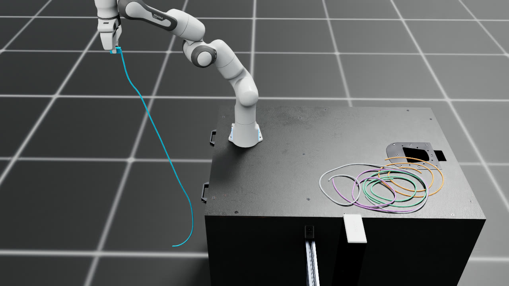

# Cable extraction

[Watch the 18.7 s, 2× presentation](media/cable-extraction.mp4) · [Original 37.4 s, 1× capture](media/cable-extraction-1x.mp4)



A joint-actuated Franka Panda grasps the blue cable's molded pull tab from the workbench, lifts it through the bundle, then draws the cable across the workbench and out past the front edge. The controller uses the known settled pickup pose and measured robot state. Five offset, precurved open strands start in an interleaved bundle and settle freely before recording.

PhysX advances the imported Panda articulation and a freely dynamic 18 g pull tab. Filtered finger–tab contacts measure acquisition on both fingers. The DeformX GPU solver advances all 965 rod vertices with gravity, strand–strand contacts in one workcell group and signed-distance grids baked from the imported robot and table colliders. Robot links receive rod contact wrenches about their centers of mass on the next exchange. A central spring and radial damper join the free endpoint to the tab through equal and opposite forces, including the tab's torque. The task uses no grasp attachment, pinned rod vertices or post-reset tab pose writes. Native replay reads the resulting measured poses without a physics step.

The rod model omits tab–rod mesh contact. The spring and damper couple the tab to its own strand, and the geometric audit bounds clearance between the tab and the four other strands. The rod–robot mesh solver and the PhysX finger–tab pairs have separate contact readouts. The setup uses assumed stiffness, friction and rest precurvature for this simulation.

The longer layout uses a more compliant assumed bending stiffness, 0.0010 N·m² versus 0.0014 N·m² in the earlier scene. Strand friction is 0.32 versus 0.42, and the strand-contact friction spring is 10,000 N/m versus 100,000 N/m. The runs exchange forces at 1200 Hz and use a 4800 Hz internal solver rate with 24 iterations versus 32 in the earlier scene. Segment strain and termination-gap peaks are sampled at the exchange rate. The geometry comparison therefore compares two demonstration models with different materials, routing and discretization.

## Measured run

| First settled frame | Earlier scene | Longer scene |
| --- | ---: | ---: |
| Solver vertices per strand | 73 | 193 |
| Blue strand rest length | 0.561 m | 1.249 m |
| Neighbor rest lengths | 0.927–1.089 m | 1.679–1.772 m |
| Blue strand mean segment length | 7.791 mm | 6.505 mm |
| Blue strand maximum segment length | 8.114 mm | 6.684 mm |
| Blue strand maximum tangent turn | 19.25° | 13.31° |
| Layered inter-strand crossings | 47 | 83 |
| Blue strand over/under crossings | 10 / 3 | 23 / 7 |

The 37.4 s run maintained bilateral finger contact at every sampled lift and pull frame. Net displacement from the starting position was 1.276 m for the tab and 1.420 m for the blue free tip. The largest neighboring-vertex displacement while near the target was 0.504 m. A final lateral lift cleared the remaining wrap and left the whole blue strand hanging from the held tab. In the final second, the minimum centerline distance from any part of the blue strand to any other strand was 0.720 m.

The maximum exchange-sampled segment strain was 0.151%, and the peak termination gap was 1.871 mm. At 30 Hz, the closest inter-strand segment centerlines were 6.551 mm apart, above the 5.94 mm barrier wall. The corresponding nominal jacket gap was −0.049 mm. The minimum sampled rod-vertex gap against the tabletop-height proxy was −1.753 mm. The tabletop footprint margin was 67.1 mm at initialization and 68.3 mm after settling. The imported Panda base had 74.3 mm of tabletop margin. The conservative sampled lower bound on neighbor-to-tab clearance was 42.4 mm. Rods loaded the tabletop, and the direct rod–robot SDF load readout was zero in this run. The measured grasp contact was on the rigid pull tab. The measured simulation loop took 452.7 s. The original capture plays at 1×; the 2× presentation preserves all 1,122 encoded frames at 60 fps over 18.7 s, with no interpolation or physics recomputation. Playback speed does not represent solver throughput. [Trajectory, comparison, control and capture evidence](validation.json)

In the matched open-gripper control, the initial recorded cable vertices and the full arm target sequence matched exactly. Both fingers recorded zero tab contact, the tab had zero final displacement, the free tip moved 16.2 mm, and neighboring motion during the near-contact interval was 47.9 mm. The nominal run moved a neighbor about 10.5 times as far in that interval. Earlier pilots with shorter draws left part of the long target in contact. The final sweep resolved that remaining contact while the robot held the tab. [Open-gripper control and pilot traces](validation.json)

## Reproduce on an Isaac/DeformX workstation

The validated environment uses Isaac Sim 5.1, Isaac Lab 2.3.2.post1, PyTorch 2.7.0+cu128, CUDA 12.8, Warp 1.14.0 and Blender 4.5.9. Install the repository's CUDA backend with the Warp baking dependency in the Isaac-compatible Python environment. This example uses free-root batch stepping, deterministic mode, same-workcell rod contacts and per-mesh wrench device views. An editable `ropesim` import can take precedence over a newer wheel on a shared Python environment. Confirm the loaded extension before recording. [Simulation runner](run.py) · [Geometric audit](audit.py)

Supply the official `panda_instanceable.usd` and `table_instanceable.usd` with their complete USD dependencies. The scene uses their original link names, meters and Z-up coordinates. These NVIDIA assets are supplied by the user under their original terms. Blender generates the molded pull tab, and PhysX builds a convex hull from that mesh.

The [shared asset downloader](../rack_insertion/README.md#reproduce) fetches the exact Panda/table files used here, verifies their hashes and preserves their dependencies (it also downloads the rack assets):

```bash
python -m demo.rack_insertion.assets --out runs/rack-sources
```

Run from the repository root. Use new output directories and a reusable collision cache.

```bash
blender --background --python-exit-code 1 --python demo/cable_extraction/blender_tab.py -- \
  --out /absolute/pull-tab

python -m demo.cable_extraction.run --headless \
  --robot-usd runs/rack-sources/isaac-4.5/Isaac/IsaacLab/Robots/FrankaEmika/panda_instanceable.usd \
  --table-usd runs/rack-sources/isaac-4.5/Isaac/Props/Mounts/SeattleLabTable/table_instanceable.usd \
  --tab-usd /absolute/pull-tab/pull-tab.usdc \
  --cache /absolute/collision-cache --out /absolute/extraction \
  --exchange-hz 1200 --iterations 24 --settle 2.5

python -m demo.cable_extraction.audit --data /absolute/extraction \
  --out /absolute/extraction-audit.json
```

The run exports a scene USD referencing original local dependencies and records their hashes, the 30 Hz trajectory, starting rod positions and a source snapshot. The audit re-derives bilateral grasp, free-end travel and final strand clearance. It checks all inter-strand pairs at the recorded frames, pre-settle and settled tabletop footprint margins, segment sizes, tangent turns, layered crossings and the exchange-rate sampled peak segment strain. A layered crossing counts an interior XY segment intersection whose interpolated points differ in height by at most 40 mm. The simulation separately checks sampled finger–tab penetration. Repeat with `--open-gripper` and a new output directory for the grasp control. On Linux hosts where PhysX needs `libcuda.so` and the driver exposes only the `libcuda.so.1` SONAME, put a local driver alias on the library path before launching Isaac.

Native replay requires a working Isaac RGB renderer, Pillow, and FFmpeg with `libx264` plus `ffprobe` on PATH. It verifies the recorded scene, trajectory, accepted audit and local USD layers. The side camera eases back from 28.0 to 34.5 s to keep the released strand and the remaining bundle in frame. Native DLAA uses fixed exposure and preserves its history across consecutive states. Only the first state and nonconsecutive preview cuts reset that history, followed by discarded warm-up frames; resetting every video frame caused visible tabletop flicker in the previous recording. The capture records live AA/exposure settings and unchanged authored lighting, checks recorded rigid poses and cable points, and verifies all 1122 frame hashes, zero clock advancement, timeline order and complete H.264 decode. [Temporal rendering checks](render-stability.json) compare identical static states, consecutive motion, camera motion and the encoded output separately.

```bash
python -m demo.cable_extraction.render_native --data /absolute/extraction \
  --audit /absolute/extraction-audit.json \
  --out /absolute/extraction-capture --tail-pullback
echo "$?" > /absolute/extraction-native.exit

python -m demo.cable_extraction.encode --capture /absolute/extraction-capture \
  --native-exit /absolute/extraction-native.exit --poster-frame 1121 \
  --out /absolute/extraction-media
```

Create the 2× presentation from that verified capture on the media host:

```bash
python -m demo.cable_extraction.retime \
  --source /absolute/extraction-media/cable-extraction.mp4 \
  --capture /absolute/extraction-media/capture.json \
  --out /absolute/extraction-presentation
```

Retiming halves packet timestamps and durations and verifies that every encoded frame payload remains identical. [Presentation evidence](presentation.json)

## Assets and provenance

- **Franka Panda articulation and Seattle Lab Table.** The replay and simulation reference the original NVIDIA asset trees, including the local dependencies of `Isaac/IsaacLab/Robots/FrankaEmika/panda_instanceable.usd` and `Isaac/Props/Mounts/SeattleLabTable/table_instanceable.usd` from the 4.5 asset cache. Obtain the complete trees and retain their supplied notices. [Isaac Sim asset distribution](https://docs.isaacsim.omniverse.nvidia.com/5.1.0/assets/usd_assets_overview.html) · [NVIDIA Isaac Sim licensing](https://docs.isaacsim.omniverse.nvidia.com/5.1.0/common/licenses-isaac-sim.html)
- **Molded pull tab.** The generic tab uses the same Blender-authored USD as the previous demo. The authoring manifest, asset hashes and recorded local dependencies are identified in the evidence. [Blender generator](blender_tab.py) · [Run and media provenance](validation.json)
