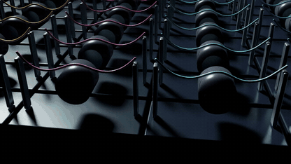

# Moving-guide contact arena

Each independent world contains a cable pinned at both endpoints and a translating roller. Gravity loads the guide, and its motion changes the cable shape and frictional force. The reference video shows the first 64 of 1,024 simulated worlds at 1× recorded speed. It opens on the front cables and guides for 1.5 s, pulls back smoothly until 5.5 s, then holds the complete 8×8 array through 24 s.

[Watch the 24-second replay](media/contact-arena-pullback-5660e2a3.mp4)



## Run

Use the [CUDA example setup](../EXAMPLES.md). From the repository root, run with NumPy, CUDA-enabled PyTorch and `ropesim`. Choose a fresh output directory each time.

```bash
python -m demo.examples contact-arena --worlds 64 --seconds 2 --out runs/arena
python -m demo.examples contact-arena --worlds 64 --seconds 2 --contact off --out runs/arena-off
python -m demo.examples contact-arena --worlds 64 --seconds 2 --substeps 160 --out runs/arena-fine
python -m demo.examples contact-arena --worlds 1024 --seconds 24 --out runs/arena-long
```

`--worlds` sets the batch size, and `--seconds` sets measured motion after the two-second default settling interval. The defaults use 120 Hz outer steps, 80 substeps and 12 iterations. See [model.py](model.py) for the 65-vertex cables, four bending stiffnesses and eight guide phases. The guide motion is prescribed. Each world has its own contact calculation.

## Interpret timing and contact

`report.json` separates numerical `complete` from `contact_qualified`, which requires every world to meet [the contact criteria](criteria.json). A contact-off control can complete with zero guide force and zero active steps. `world_contact_counts.npy` covers every world. `trajectory.npz` saves up to 64 worlds at 30 Hz and includes positions, guide poses and guide reaction wrenches. The renderer translates the world coordinates for display.

In the reference 24-second RTX 5090 recording, each of the 1,024 worlds had 2,876–2,880 active measured steps out of 2,880. That run measured a 14.41 ms median timed call, 71,057 aggregate world-steps/s and 0.58× per-world real-time factor. Timing includes the preloaded guide pose update, the solver call and CUDA synchronization. Setup, data upload, diagnostics, output and rendering fall outside this window. Use `timing_ms.npy` and `report.json` to report the scope and hardware for a new measurement.

For a scaling comparison, repeat matching contact-on and contact-off runs at 64, 256 and 1,024 worlds with the same duration, GPU and numerical settings. `python -m demo.contact_arena.analyze --help` lists the comparison inputs. The reported force is the selected solver's cable-on-guide reaction averaged over one outer step. Gap, strain and force comparisons describe the sampled states and the selected resolution.

## Replay saved states

Generate original display hardware in Blender, then use Isaac Sim Python with Pillow, FFmpeg and DejaVu Sans. On Ubuntu the font is in `fonts-dejavu-core`. The render holds the physics clock fixed.

```bash
blender -b -t 4 --python-exit-code 1 \
  --python demo/contact_arena/blender_assets.py -- --out runs/arena-assets
# Run with the Isaac Sim Python interpreter.
python -m demo.contact_arena.render --data runs/arena-long \
  --assets runs/arena-assets --out runs/arena-video
```

The packaged pullback video replays the original 720 saved states without advancing physics. Its [presentation record](presentation.json) and [camera replay recipe](media/replay_reference_camera.py) document the camera, native capture and source hashes. That archival recipe requires the original source, trajectory, Blender assets and reference RGB capture; the commands above run a fresh example. The original wide-opening video remains archived as `media/contact-arena-long.mp4`. The revised capture explicitly selects the Blender assets' dark HDR environment, with the original distant light and materials preserved. A matched-camera reference-frame check guards against a different startup appearance.
