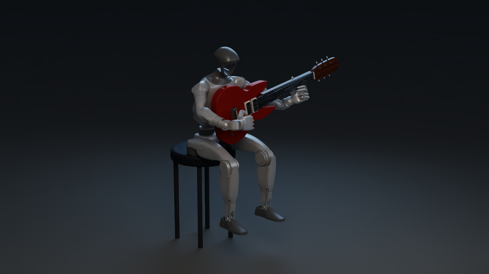

# Humanoid guitar strumming

[](media/humanoid-guitar-fullbody-long.mp4)

[Play the 15.93-second video](media/humanoid-guitar-fullbody-long.mp4)

The left hand holds the neck and frets the strings while the right-hand pick sweeps five strings repeatedly. The video begins with a 4× slow-motion close-up, pulls back, then shows 9.8 seconds of the full robot at normal speed. Initialization is omitted.

The [eight-second gallery preview](media/humanoid-guitar-preview.mp4) uses a faster edit: 2 seconds of pick close-up, about 1 second of pullback, then about 5 seconds of the full robot. The opening plays at 0.5× simulation speed and the full-body section at 1×. Its [frame mapping](presentation.json) identifies every source frame; physics and camera poses are unchanged.

String motion comes from the DeformX CUDA rod solver with instrument, pick and finger collision geometry. Robot motion is prescribed; the pelvis and guitar are fixed. This demonstrates contact-driven string deflection, not an autonomous playing policy or an acoustic model.

## Run the example

The example generates the seated robot motion and simulates six strings for 12.45 seconds at 480 Hz, after two seconds of settling. The pick makes 24 alternating strokes across strings 1–5 while the left hand frets string 6. Only the string endpoints are pinned. The simulation needs a CUDA GPU; Isaac Sim is only needed to turn the saved states into a video.

1. Follow the [CUDA example installation](../EXAMPLES.md#installation) for Python 3.11, CUDA PyTorch and the pinned `ropesim` submodule (`96b8514c7c55c724f1abba1fbf6ed6642b7db72b`). Install the additional Python dependencies and [Blender 4.5.9 LTS](https://download.blender.org/release/Blender4.5/). Blender creates the props and exports the visible USD and collision meshes. The pose checks bind to exact mesh hashes, so use the tested Blender version.

   ```bash
   python -m pip install scipy==1.15.3 trimesh==4.5.1 warp-lang==1.14.0
   ```

2. From the repository root, choose a new asset directory and run directory. Preparation downloads and verifies the source models, then builds the baseline, instrument contact meshes, hands and pick. It needs internet access on the first run. To download first or reuse an already verified download, run `python -m demo.humanoid_guitar.fetch_assets --out "$ASSETS/sources"` before `prepare`.

   ```bash
   ASSETS="$PWD/runs/guitar-assets"
   RUN="$PWD/runs/guitar-run"
   BLENDER=/path/to/blender

   python -m demo.humanoid_guitar.run prepare --assets "$ASSETS" --blender "$BLENDER"
   python -m demo.humanoid_guitar.run --assets "$ASSETS" --out "$RUN"
   python -m demo.humanoid_guitar.run audit --out "$RUN"
   ```

   The `guitar` alias in `python -m demo.examples` accepts the same arguments. Use `--gpu-lock /path/to/gpu.lock` for the `run` and `render` commands when sharing a GPU. The default solver settings are 200 substeps and 24 iterations per recorded interval; `--substeps 300` requests the slower temporal setting. The physical simulation and settling took about 14 minutes on an RTX 5090, excluding preparation and rendering. Keep the prepared asset directory in place; the generated profiles store absolute paths and checksums.

3. To render, switch to an [Isaac Sim 5.1.0 Python environment](https://docs.isaacsim.omniverse.nvidia.com/5.1.0/installation/install_python.html) with Pillow, SciPy and Trimesh, and install FFmpeg with `libx264` and `ffprobe`. On a Linux host whose NVIDIA Vulkan driver needs an X session, set `DISPLAY` and `XAUTHORITY` for that session. From the same checkout, with the same `RUN`:

   ```bash
   python -m demo.humanoid_guitar.run render --out "$RUN"
   ```

The solver writes `case/report.json`, `case/trajectory.npz` and the generated robot `case/motion.npz`. The audit measures all 120 stroke/string channels, contact order and release, transverse string displacement, opposing fingertip and fifth-fret loads, and numerical stability. It returns nonzero when a required check fails. In the fresh run, all 24 strokes contacted the five strings in order and all 5,425 visible states had opposing fingertip and fret support on string 6. The pick registered zero load at the turnarounds. This is a single-case check; it does not repeat the archived control, temporal/spatial comparisons or dense penetration audit.

A successful render writes `native/humanoid-guitar-fullbody-long.mp4`, the native frames and their mapping to the recorded states. It requires a passing audit of that exact trajectory, and checks framing and full video decode. It does not step the solver. The [fresh validation record](evidence/portable-validation.json) includes the solver, assets, audit, replay and video checksums.

## Assets and provenance

- Unitree G1 29-DOF revision 1.0 with Inspire DFQ hands: [unitree_ros, revision 41dec58](https://github.com/unitreerobotics/unitree_ros/tree/41dec58c7a3ccb3050243ef16ac2ca74b2b0f9ca/robots/g1_description), [BSD-3-Clause](licenses/UNITREE-BSD-3-Clause.txt). [Pinned URDF](https://raw.githubusercontent.com/unitreerobotics/unitree_ros/41dec58c7a3ccb3050243ef16ac2ca74b2b0f9ca/robots/g1_description/g1_29dof_rev_1_0_with_inspire_hand_DFQ.urdf) SHA-256: `e2b2d6bfe58f6b8d57b9f28df9ad9e5e5d0ea728f562e925b8b1482a902b6ff3`.
- Guitar: [Innerscene solid-body electric guitar](https://www.innerscene.com/tools/library/3d-parts/solid-body-electric-guitar-76088e09), published as CC0. [Original GLB](https://files.innerscene.com/library/solid-body-electric-guitar-76088e09/74e944633844ec57d5d6/solid-body-electric-guitar.glb) SHA-256: `91878d0e616c4dbbfa4bbeb7abbe9caf9a0f6d3c779cfe944a7fead7d84ad148`.
- Stool, pick and floor props: original Blender scene geometry generated by `prepare`.
- Recording source: DeformX experiment revision `5de1d32`; CUDA backend `708e0a9`. Isaac Sim rendering on an RTX 5090. The clean presentation replays the same saved states without the original title and status overlays.

The [asset manifest](asset_sources.json) pins all 63 input files by URL, byte size and SHA-256. No robot or guitar model files are bundled. The preparation uses the original URDF joint origins, limits and meshes. It preserves the guitar materials and original bridge/nut endpoints, removes only the playable span of the old visual strings, lowers the pickup covers and poles by 5 mm for clearance, and cuts the bridge and nut slots. The contact scene uses the visible guitar geometry, all 26 hand links split into closed shells, and the same rounded pick mesh used for rendering. The pose template stores setup and joint data; each run calculates the motion and solves the string trajectory from scratch.

The MP4 has 478 frames at 30 fps, 1280 × 720, no audio. SHA-256: `6776de6c8623cd4c9cae3d9aefb6b7d8d870ff8328a55112e1db10f6867723b5`.
