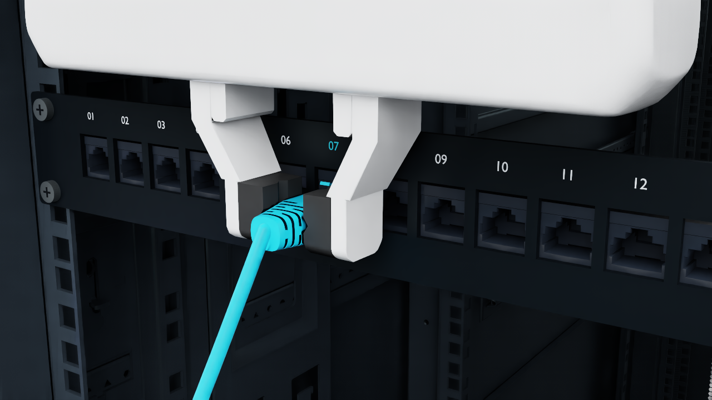

# Robot rack insertion

[](media/rack-insertion.mp4)

[Play the 14.8-second video](media/rack-insertion.mp4)

A Franka Panda carries a contact-held connector to port 07 of a rack-mounted 24-port panel, inserts it, opens its fingers and withdraws. The plug is a freely dynamic PhysX body coupled to an unpinned deformable cable through a compliant termination. The controller uses known initial placement and simulated poses and pair-contact sensors. The temporary world support used for initial cable settling is disabled before acquisition.

## Reproduce

Run from the repository root. Use a Linux Python 3.11 environment with the [release CUDA solver](../../README.md#the-gpu-rod-solver), [Isaac Sim 5.1.0](https://docs.isaacsim.omniverse.nvidia.com/5.1.0/installation/install_python.html), [Isaac Lab 2.3.2.post1](https://pypi.org/project/isaaclab/2.3.2.post1/) including its `isaaclab_assets` module, and PyTorch 2.7.0 with CUDA 12.8. The simulation and collision-grid bake use NumPy 1.26.0, SciPy 1.15.3, Trimesh 4.5.1 and Isaac Sim's bundled Warp 1.8.2. The launcher starts Isaac before importing `ropesim` so Kit can load its compatible Warp. Native render also needs an Isaac-compatible RTX graphics setup, Pillow, FFmpeg with libx264, and FFprobe.

Isaac loads `Isaac/Environments/Grid/default_environment.usd` from its standard 5.1 environment assets, separate from the pinned model downloads below. The runtime needs access to NVIDIA's asset server or a local Isaac 5.1 asset root containing that environment and its dependencies. For a local installation, configure Isaac Lab's `/persistent/isaac/asset_root/cloud` setting to that root. [Isaac asset root setup](https://docs.isaacsim.omniverse.nvidia.com/5.1.0/installation/install_faq.html)

Asset preparation uses Blender 4.5 and standalone OpenUSD. Use a separate Python 3.11 environment for this step so that `usd-core` does not shadow the USD bindings shipped with Isaac Sim.

```bash
python -m venv .rack-authoring
.rack-authoring/bin/python -m pip install 'usd-core==25.5.1' 'numpy==1.26.0'
python -m demo.rack_insertion.assets --out runs/rack-sources
.rack-authoring/bin/python -m demo.rack_insertion.prepare \
  --sources runs/rack-sources --out runs/rack-assets --blender /path/to/blender
```

The downloader verifies SHA-256 for all [42 pinned files](asset_sources.json). It can run on a networked machine, then you can transfer the complete source directory to the Isaac host for preparation. The preparation command verifies that directory again and produces `profile.json`, the extracted connector USDs, Blender source scenes and exported geometry, and the mounted rack overlay. Keep the source and prepared directories at the paths recorded in the profile while running and rendering. Blender authoring on the validation host emitted standalone USD warnings for `OmniPBR.mdl`, which Isaac supplies at runtime.

Activate the Isaac/DeformX environment and accept NVIDIA's EULA as described in its installation instructions. Use new output paths.

```bash
python -m demo.examples rack-insertion --profile runs/rack-assets/profile.json --out runs/rack-trial
python -m demo.rack_insertion.audit --data runs/rack-trial --out runs/rack-audit.json
python -m demo.rack_insertion.render --data runs/rack-trial --out runs/rack-render
```

The standalone simulation command is `python -m demo.rack_insertion.run` with the same arguments. The headless run settles the cable for 1.5 s, then performs acquisition, lift, hold, routing, alignment, insertion, finger opening, and withdrawal. Isaac and DeformX exchange at 1,200 Hz, with four rod substeps per exchange and 96 rod solver iterations. The example writes the USD scene, 30 Hz measured trajectory, physical diagnostics and run-local collision grids. The audit independently scores the measured acquisition and final retention. It requires at least 0.5 s of stable retention after the TCP has moved at least 50 mm upward from its release-entry pose. The native renderer replays the new run with physics disabled and writes `rack-insertion.mp4` at 30 fps and 1×. Use `--preview` to capture a handful of still frames.

The fresh `ps` trial rebuilt its assets and collision grids, simulated 20.07 s, and passed the acquisition and retention checks. The plug stayed seated for 1.30 s after a measured 119.94 mm withdrawal. Native replay captured and decoded all 602 frames at 1280 × 720. [Fresh validation results and commands](evidence/portable-validation.json)

## Assets and provenance

- Franka Panda and Seattle Lab Table come from the official [NVIDIA Isaac Sim 4.5 assets](https://docs.isaacsim.omniverse.nvidia.com/4.5.0/installation/download.html). The same files can be copied from an official download of that release while preserving the paths in the manifest. [Asset URLs and SHA-256](asset_sources.json) · [NVIDIA licensing](https://docs.isaacsim.omniverse.nvidia.com/5.1.0/common/licenses-isaac-sim.html)
- Vertiv VR3307 rack by **Vertiv**. The service overlay removes the front split doors and repositions the front rails. Native replay applies a graphite material. Preserve this attribution with redistributed clips. [Pinned VR3307 source](https://huggingface.co/datasets/Vertiv/simready-assets/tree/38c9c1a3de37b6b00944fd57384819842b3ff0aa/VR3307) · [CC BY 4.0](https://creativecommons.org/licenses/by/4.0/)
- Matched RJ45 plug, socket and latch by **Newton Developers**. Preparation extracts the three component meshes and authors collider and mass settings. [Pinned source](https://github.com/newton-physics/newton/blob/f1aa3296cb984e9a341f92f5a335b0d807632cc9/newton/examples/assets/rj45_plug.usd) · [Apache-2.0 notice](licenses/NEWTON-Apache-2.0.txt)
- Keystone faceplate by **Tomas Franzén**. The Blender generator adapts the plate to the rack, preserves the 24 original apertures, and adds carrier rings, port numbers and screws. [Pinned source](https://github.com/tomasf/keystone-patch-panel/tree/33b2e66203d57256e38e85a160be145cd03f3a86) · [MIT notice](licenses/keystone-patch-panel-MIT.txt)
- Guide, pedestal and strain-relief visualization are original Blender geometry.

## Gallery recording

The gallery clip uses physical experiment revision `4c8f2bd`. It starts from a stable hold at simulation time 5.30 s and plays 444 native frames at 30 fps and 1×. The full trial recorded 2.93 s of retention after opening, including 1.30 s after a measured 119.94 mm hand withdrawal. Native DLAA and renderer history warmup at camera cuts reduce shimmer on the grille and port numbering. [Recorded task results](evidence/recorded-results.json) · [Clean replay provenance](evidence/clean-replay.json) · [Temporal rendering checks](evidence/render-stability.json)

The trial uses assumed connector and termination parameters. Peak termination force differed by 37.4% in the selected timestep checks, so the demonstration does not establish force accuracy, hardware transfer or electrical connection. The original 20.07 s simulation took 329.91 s of loop wall time.
