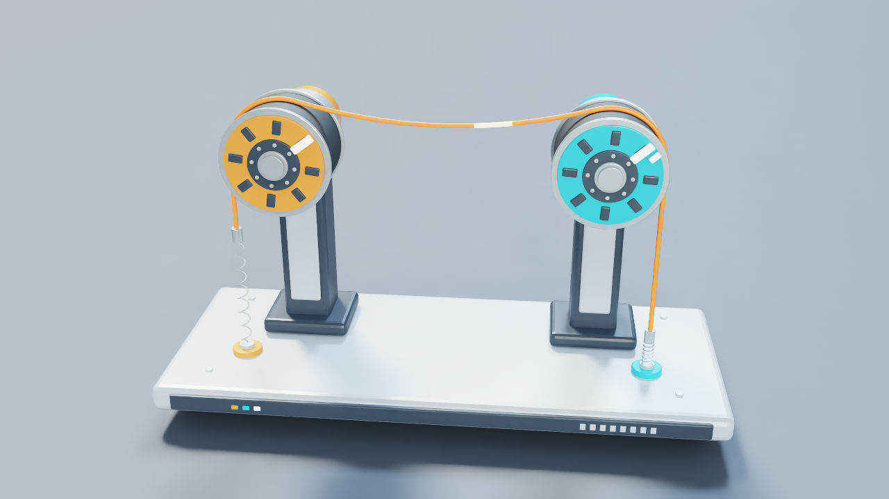

# Traction reels

A tensioned cable feeds, pauses and reverses across two reels. The amber reel has a prescribed motor angle. Cable contact torque turns the blue reel against a viscous brake. Two compliant end tethers maintain tension, and the pale band tracks the same cable material through each cycle.

[Watch eight cycles at 1×](media/winch-tension-long.mp4)



## Run

Use the [CUDA example setup](../EXAMPLES.md) and run from the repository root with NumPy, CUDA-enabled PyTorch and `ropesim`. Choose a fresh output directory.

```bash
python -m demo.examples winch --duration-s 0.8 --out runs/reels-smoke
python -m demo.examples winch --out runs/reels
python -m demo.examples winch --cycles 8 --out runs/reels-long
python -m demo.winch_tension.analysis runs/reels-long
```

The default barrel surface speed is 0.075 m/s and the default trial runs one cycle. The eight-cycle trial lasts 26.55 s with settling. The cable and passive axle retain their state between cycles. Use `--speed-m-s` to change feed speed. `--exchange-hz` and `--rod-hz` default to 240 and 4800 Hz.

```bash
python -m demo.examples winch --cycles 8 --mode still --out runs/reels-still
python -m demo.examples winch --cycles 8 --mode frictionless --out runs/reels-frictionless
python -m demo.examples winch --exchange-hz 480 --rod-hz 9600 --out runs/reels-fine
python -m demo.winch_tension.analysis runs/reels-long runs/reels-still runs/reels-frictionless
```

The still control fixes the motor angle. The frictionless control keeps motor motion and normal contact. In the reference eight-cycle run, the marker traveled about 80 mm on each feed and 81 mm on each reverse. Both controls completed numerically and failed the transport checks in every cycle. Single-cycle refinements preserved transport and changed peak passive torque. Read `complete` and `metrics.task_success` separately. The 0.8 s smoke run ends before the reverse and is ineligible for the full-cycle checks.

## Model and replay

The model uses a 129-vertex Cosserat rod with an 8 mm diameter. Each 85 mm radius contact barrel uses a moving signed-distance grid. The right axle applies the previous exchange's cable torque and a viscous brake. The contacts transport the cable over partial wraps on fixed-radius barrels. Force and torque readouts come from the numerical model.

`trajectory.npz` contains the source clock, cable positions and velocities, reel angles, barrel wrenches, and contact and tether forces. Positions use metres, forces use newtons and torques use N·m. `report.json` records per-cycle motion, contact and work checks, timing and source hashes.

Generate the visual assembly in Blender 4.5 or newer, then replay using Isaac Sim Python with Pillow, FFmpeg and FFprobe. The replay samples the recorded motion at 30 fps and starts after settling. Add `--include-settle` to show the start.

The displayed video uses a separately validated native DLAA replay to reduce shimmer on the indicator strip and plate edges. All 781 recorded states, lighting and camera cuts match the original. The portable renderer remains unchanged: startup appearance was sensitive to initialization order in the experimental replay, so that procedure is not presented as a general renderer fix. [Temporal rendering checks and limitations](render-stability.json)

```bash
blender -b --factory-startup --python-exit-code 1 \
  --python demo/winch_tension/blender_reels.py -- --out runs/reel-assets
# Run with the Isaac Sim Python interpreter.
python -m demo.winch_tension.render --data runs/reels-long \
  --assets runs/reel-assets --out runs/reel-video
```
